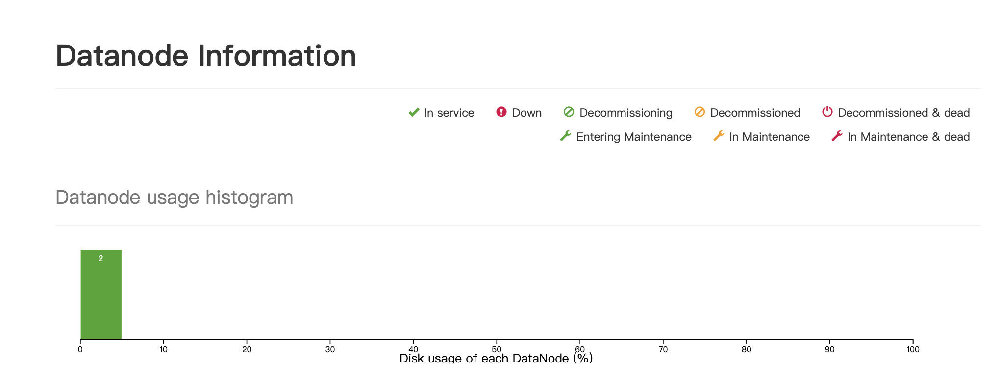
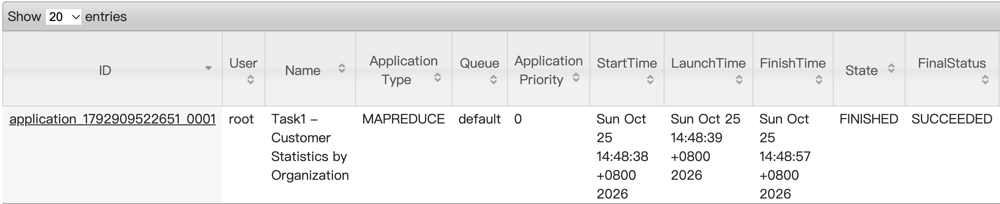
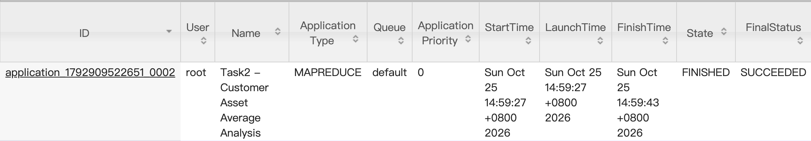
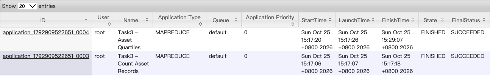
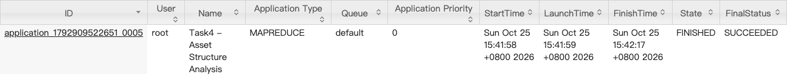
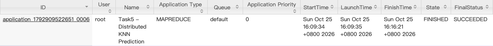

# 实验2：基于 MapReduce 的用户信贷数据分析

## 一、实验环境检查与配置

### 1.1 实验环境

本实验基于 Hadoop MapReduce 分布式计算框架，使用 Java 实现银行用户信贷数据的统计分析与风险预测。开发环境采用 macOS，使用 Maven 管理 Java 项目，通过 Docker 部署 Hadoop 分布式集群。

具体实验环境如下：

| 组件 | 版本或配置 |
|---|---|
| 操作系统 | macOS（Apple Silicon，ARM64） |
| Java 开发环境 | Amazon Corretto JDK 11.0.28 |
| Maven | Apache Maven 3.10.0 |
| Docker | Docker 29.7.2 |
| Hadoop | Hadoop 3.2.1 |
| Hadoop 容器运行环境 | Java 8 |
| 开发工具 | Visual Studio Code |
| 编程语言 | Java |
| 构建方式 | Maven |
| 分布式计算框架 | Hadoop MapReduce |
| 分布式文件系统 | HDFS |
| 资源管理框架 | YARN |

由于本机使用 JDK 11，而 Hadoop Docker 容器使用 Java 8，因此在 `pom.xml` 中将 Java 编译目标设置为 Java 8，以保证编译生成的 JAR 能够在 Hadoop 容器中正常运行。

主要 Maven 配置如下：

```xml
<properties>
    <project.build.sourceEncoding>UTF-8</project.build.sourceEncoding>
    <hadoop.version>3.2.1</hadoop.version>
    <maven.compiler.release>8</maven.compiler.release>
</properties>
```

同时使用 `hadoop-client` 依赖，并将依赖范围设置为 `provided`，使程序编译时能够使用 Hadoop API，而在运行时使用 Hadoop 集群已经提供的相关类库。

### 1.2 Hadoop 集群部署

本实验使用 Docker 部署 Hadoop 集群，集群包含1个 NameNode、2个 DataNode、1个 ResourceManager 和2个 NodeManager。

各容器的作用如下：

| 容器名称 | 组件 | 作用 |
|---|---|---|
| hadoop-master | NameNode | 管理 HDFS 文件系统的元数据 |
| hadoop-worker1 | DataNode | 存储 HDFS 数据块 |
| hadoop-worker2 | DataNode | 存储 HDFS 数据块 |
| yarn-resourcemanager | ResourceManager | 负责集群资源管理与任务调度 |
| yarn-nodemanager1 | NodeManager | 执行 MapReduce 计算任务 |
| yarn-nodemanager2 | NodeManager | 执行 MapReduce 计算任务 |

启动 Docker Desktop 和 Hadoop 集群后，通过以下命令查看容器状态：

```bash
docker ps
```

检查结果显示，6个 Hadoop 容器均成功启动。

### 1.3 HDFS 环境检查

使用以下命令检查 HDFS 的运行状态：

```bash
docker exec hadoop-master hdfs dfsadmin -report
```

实际检查结果包括：

- Live DataNodes：2
- Blocks with corrupt replicas：0
- Missing blocks：0
- Under replicated blocks：2

说明两个 DataNode 均已正常连接 NameNode，HDFS 能够提供文件存储服务。检查时存在两个副本不足的数据块，但没有检测到损坏或丢失的数据块。

通过以下命令检查 HDFS 文件系统：

```bash
docker exec hadoop-master hdfs dfs -ls /
```

命令能够正常列出 HDFS 根目录中的文件和文件夹，说明 HDFS 文件访问功能正常。

### 1.4 YARN 环境检查

使用以下命令检查 YARN 节点：

```bash
docker exec yarn-resourcemanager yarn node -list
```

检查结果显示：

```text
Total Nodes: 2

nodemanager1    RUNNING
nodemanager2    RUNNING
```

说明两个 NodeManager 均已成功注册并处于运行状态，集群能够为 MapReduce 作业分配计算资源。

同时通过浏览器访问 Hadoop 的 Web 管理页面：

- HDFS NameNode：http://localhost:9870
- YARN ResourceManager：http://localhost:8088

通过 Web 页面可以查看 HDFS 状态、YARN 节点信息、MapReduce 作业执行进度以及最终执行状态。

**环境检查截图：**



### 1.5 项目目录结构与数据准备

本实验使用 Maven 构建项目，Java 源代码直接存放在 `src` 目录中。

项目结构如下：

```text
experiment2/
├── data/
│   ├── train.csv
│   └── test.csv
│
├── src/
│   ├── Task1.java
│   ├── Task2.java
│   ├── Task3.java
│   ├── Task4.java
│   └── Task5.java
│
├── target/
│   └── experiment2.jar
│
├── output/
│   ├── task1/
│   ├── task2/
│   ├── task3/
│   ├── task4/
│   └── task5/
│
├── pom.xml
├── .gitignore
└── README.md
```

其中：

- `data`：保存原始训练集和测试集。
- `src`：保存五个实验任务的 Java 源代码。
- `target`：保存 Maven 编译生成的 JAR 文件。
- `output`：保存各任务从 HDFS 导出的运行结果。
- `pom.xml`：管理 Maven 依赖、Java 编译版本及打包配置。
- `README.md`：保存实验设计思路、运行结果和分析报告。

实验数据来自 DataFountain 用户逾期行为预测数据集。原始数据经过字段筛选后，保留15个与本次实验相关的字段。

训练集 `train.csv` 包含客户特征和 `bad_good` 标签，测试集 `test.csv` 包含客户特征但不包含预测标签。

任务1～4使用 `train.csv`，任务5同时使用 `train.csv` 和 `test.csv`。

为了方便运行，将数据上传至 HDFS：

```bash
docker cp data/train.csv hadoop-master:/tmp/train.csv
docker cp data/test.csv hadoop-master:/tmp/test.csv

docker exec hadoop-master hdfs dfs -mkdir -p /experiment2/input

docker exec hadoop-master hdfs dfs -put -f \
/tmp/train.csv /experiment2/input/train.csv

docker exec hadoop-master hdfs dfs -put -f \
/tmp/test.csv /experiment2/input/test.csv
```

检查数据文件：

```bash
docker exec hadoop-master hdfs dfs -ls /experiment2/input
```

后续使用 Maven 编译项目：

```bash
mvn clean package
```

生成 `target/experiment2.jar` 后，将 JAR 复制到 Docker 容器中：

```bash
docker cp target/experiment2.jar \
hadoop-master:/tmp/experiment2.jar
```

由此完成整个实验的运行环境准备。

---

## 二、Task1：各开户机构客户数量及资产统计

### 2.1 实验目标

根据 `train.csv` 中的客户数据，按照开户机构编号 `OPEN_ORG_NUM` 进行分组，统计各机构的：

1. 客户数量。
2. 客户资产总额。
3. 客户负债总额。
4. 个贷逾期客户数量。

其中客户资产总额使用 `CUST_ASSET_AMT`，负债总额使用 `CUST_DEBT_AMT`。

程序将缺失金额按0处理。逾期人数统计暂按照 `bad_good=1` 表示逾期的约定实现，实际业务含义应以原始数据集标签说明为准。

### 2.2 实验思路

本任务属于分组聚合问题，采用 Hadoop MapReduce 实现。

**Map 阶段：**

Mapper 逐行读取 `train.csv`，解析客户的开户机构、资产总额、负债总额以及逾期标签。

以开户机构编号作为 Key，以客户数量、资产金额、负债金额和逾期标记作为 Value。

Mapper 输出形式为：

```text
<机构编号, (1, 资产金额, 负债金额, 逾期标记)>
```


**Shuffle 阶段：**

Hadoop 根据机构编号进行分组，将同一机构的记录发送给同一个 Reducer。

**Combiner 阶段：**

为减少 Shuffle 过程中的网络传输量，使用 Combiner 对 Mapper 输出进行局部聚合，提前计算同一机构的客户数量、资产总额、负债总额和逾期人数。

**Reduce 阶段：**

Reducer 对同一机构的统计结果进行累加，输出该机构最终的四项统计指标。

为避免金额累加时出现明显的浮点精度问题，程序使用 `BigDecimal` 保存和计算金额。

### 2.3 实验关键步骤

**步骤1：编写 MapReduce 程序**

在 `src/Task1.java` 中实现：

- `Task1Mapper`
- `Task1Combiner`
- `Task1Reducer`
- `main` 驱动程序

程序通过 CSV 表头查找字段位置，处理缺失金额，并设置 Mapper、Combiner、Reducer 的输入输出类型。

**步骤2：编译打包**

```bash
mvn clean package
```

将生成的 JAR 上传到 Docker 容器：

```bash
docker cp target/experiment2.jar \
hadoop-master:/tmp/experiment2.jar
```

**步骤3：提交 MapReduce 作业**

```bash
docker exec hadoop-master hadoop jar \
/tmp/experiment2.jar Task1 \
/experiment2/input/train.csv \
/experiment2/output/task1
```

**步骤4：查看并导出结果**

```bash
docker exec hadoop-master hdfs dfs -cat \
/experiment2/output/task1/part-r-00000
```

将结果保存到本地：

```bash
mkdir -p output/task1

docker exec hadoop-master hdfs dfs -cat \
/experiment2/output/task1/part-r-00000 \
> output/task1/part-r-00000
```

### 2.4 实验结果

任务1已完成运行。

输出格式为：

```text
开户机构编号<TAB>客户数量,总资产,总负债,逾期客户数量
```

**实际统计结果(部分)：**

```text
1001	1254,184485852.19,112193577.37,32
1002	793,85762009.43,28727466.60,5
1003	887,116772867.93,23132764.24,9
1004	731,71218296.34,21648579.65,11
1005	782,160495773.61,30385710.68,8
1006	527,57815976.80,30199794.73,3
1007	791,94612718.14,66476020.30,3
1008	662,69130797.73,20573733.63,2
1009	1127,137475346.84,31413983.45,3
101	1241,293699077.32,131735191.75,54
```

**运行截图：**



**结果分析：**

通过本任务可以观察不同开户机构的客户规模、资产规模、负债规模及逾期客户分布，为后续分析机构内客户的资产差异提供统计基础。

---

## 三、Task2：各开户机构客户资产平均值分析

### 3.1 实验目标

在 Task1 统计结果的基础上，计算每个开户机构的平均客户资产，并统计：

1. 资产大于或等于所属机构平均资产的客户数量。
2. 资产低于所属机构平均资产的客户数量。

根据实验要求，当客户资产恰好等于平均值时，将其归入大于等于平均值的客户组。

### 3.2 实验思路

本任务需要同时使用原始训练数据和 Task1 的统计结果，因此采用 **DistributedCache + MapReduce** 实现。

**第一步：计算各机构平均资产**

Task1 输出了各开户机构的客户数量和总资产，因此可以通过以下公式计算平均资产：

$$
\overline{A}_{org}=
\frac{\text{机构总资产}}{\text{机构客户数量}}
$$

**第二步：通过 DistributedCache 加载 Task1 结果**

将 Task1 的 `part-r-00000` 加入 DistributedCache，使每个 Mapper 能够在初始化阶段读取机构统计信息。

Mapper 在内存中建立以机构编号为 Key 的映射结构，保存对应的客户数量和资产总额。

**Map 阶段：**

读取每位客户所属的开户机构及其资产金额，与该机构平均资产进行比较。

为了避免直接计算平均值产生除法精度问题，程序使用等价比较：

$$
A_i\times N_{org}\geq A_{org}
$$

其中：

- $A_i$：当前客户资产。
- $N_{org}$：机构客户数量。
- $A_{org}$：机构总资产。

如果满足条件，则将高于等于平均值的客户数量加1，否则将低于平均值的客户数量加1。

Mapper 输出：

```text
机构编号 -> (1,0)
```

或者：

```text
机构编号 -> (0,1)
```

**Combiner 阶段：**

对相同机构的两类客户计数进行局部累加，减少数据传输量。

**Reduce 阶段：**

汇总同一机构的高于等于平均值人数和低于平均值人数，形成最终结果。

### 3.3 实验关键步骤

**步骤1：编写 Task2.java**

实现 Mapper、Combiner、Reducer，并通过 DistributedCache 加载 Task1 的统计结果。

**步骤2：编译打包**

```bash
mvn clean package
```

上传 JAR：

```bash
docker cp target/experiment2.jar \
hadoop-master:/tmp/experiment2.jar
```

**步骤3：提交 MapReduce 作业**

```bash
docker exec hadoop-master hadoop jar \
/tmp/experiment2.jar Task2 \
/experiment2/input/train.csv \
/experiment2/output/task1/part-r-00000 \
/experiment2/output/task2
```

其中第二个路径参数为 Task1 的统计结果文件。

**步骤4：查看结果**

```bash
docker exec hadoop-master hdfs dfs -cat \
/experiment2/output/task2/part-r-00000
```

导出到本地：

```bash
mkdir -p output/task2

docker exec hadoop-master hdfs dfs -cat \
/experiment2/output/task2/part-r-00000 \
> output/task2/part-r-00000
```

### 3.4 实验结果

任务2已完成运行。

输出格式为：

```text
开户机构编号<TAB>大于等于平均值客户数量,低于平均值客户数量
```

**实际统计结果(部分)：**

```text
1001	232,1022
1002	106,687
1003	144,743
1004	144,587
1005	83,699
1006	104,423
1007	130,661
1008	154,508
1009	165,962
101	203,1038
```

**运行截图：**



**结果分析：**

通过比较机构内高于平均资产和低于平均资产的客户数量，可以初步观察不同开户机构客户资产分布的差异。

同时，可以将 Task2 两类客户的数量之和与 Task1 的对应机构客户总数进行比较，以检查两个任务的统计结果是否一致。

---

## 四、Task3：客户总资产四分位数计算

### 4.1 实验目标

依据 `CUST_ASSET_AMT` 字段，计算全部客户资产总额的三个四分位数：

- Q25：25% 分位数。
- Q50：50% 分位数，即中位数。
- Q75：75% 分位数。

本任务重点学习 Hadoop MapReduce 的 Shuffle 自动排序机制，通过分布式计算得到全局有序的资产数据，并计算对应位置的四分位数。

### 4.2 实验思路

本任务采用**两个 MapReduce Job** 完成。

#### Job1：统计有效资产记录总数

Mapper 读取 `train.csv`，提取客户资产总额，对缺失值进行处理，并通过 Hadoop Counter 统计有效资产记录数量。

每读取一条有效资产记录，执行：

```java
context.getCounter(
    AssetCounter.VALID_ASSET
).increment(1);
```

由于本阶段只需要获得样本总数，因此不设置 Reducer。

Job1 完成后，Driver 从 Hadoop Counter 中获取有效样本数量 $N$。

#### Job2：资产排序与四分位数计算

**Map 阶段：**

Mapper 提取每位客户的资产总额，并将其作为 `DoubleWritable` 类型的 Key 输出。

```java
context.write(
    new DoubleWritable(asset),
    NullWritable.get()
);
```

由于只需要资产金额，不需要额外的 Value，因此使用 `NullWritable`。

**Shuffle 阶段：**

Hadoop 自动根据资产 Key 进行升序排序，并将相同资产金额的记录归为一组。

本实验没有直接使用 `Arrays.sort()` 或 `Collections.sort()` 对全部客户数据进行排序，而是利用 MapReduce 框架自带的排序机制。

**Reduce 阶段：**

为保证全局有序，设置一个 Reducer。

Reducer 依次处理不同资产金额对应的 Key，并统计每个资产值出现的次数，通过累计频数确定该金额在全局排序序列中占据的位置。

本实验使用线性插值法计算分位数。

对于分位数 $p$，其位置为：

$$
Position=(N-1)\times p
$$

其中 $p$ 分别取0.25、0.50和0.75。

如果计算位置不是整数，则使用相邻两个位置的资产值进行线性插值。

最终在 Reducer 的 `cleanup()` 阶段输出三个分位数。

这种方式不需要将全部客户资产数据一次性加载到内存中。

### 4.3 实验关键步骤

**步骤1：编写 Task3.java**

程序主要包含：

- `CountMapper`：统计有效资产记录数量。
- `SortMapper`：输出资产数值作为排序 Key。
- `QuartileReducer`：根据排序位置计算四分位数。
- `main`：依次执行两个 MapReduce Job。

**步骤2：编译打包**

```bash
mvn clean package
```

上传 JAR：

```bash
docker cp target/experiment2.jar \
hadoop-master:/tmp/experiment2.jar
```

**步骤3：提交任务**

```bash
docker exec hadoop-master hadoop jar \
/tmp/experiment2.jar Task3 \
/experiment2/input/train.csv \
/experiment2/output/task3
```

程序先执行样本计数 Job，再执行资产排序与分位数计算 Job。

**步骤4：查看运行结果**

```bash
docker exec hadoop-master hdfs dfs -cat \
/experiment2/output/task3/part-r-00000
```

导出结果：

```bash
mkdir -p output/task3

docker exec hadoop-master hdfs dfs -cat \
/experiment2/output/task3/part-r-00000 \
> output/task3/part-r-00000
```

### 4.4 实验结果

Task3 的第一个 Job 统计结果为：

```text
Map input records = 285286
VALID_ASSET = 285285
```

说明共读取285,286行数据，其中包含1行表头，最终参与分位数计算的有效资产记录为：

**N = 285,285**

第一个 Job 的执行状态为 `SUCCEEDED`。

第二个 Job 完成资产排序与四分位数计算，最终成功运行。

实际四分位数为：

| 指标 | 计算结果 |
|---|---|
| Q25 | 1127.35 |
| Q50 | 6501.38 |
| Q75 | 49173.11 |

**实际输出：**

```text
Q25:1127.35	Q50:6501.38	Q75:49173.11
```

**运行截图：**



**结果分析：**

Task3 得到的 Q25、Q50 和 Q75 反映了客户总资产的分布情况，可以作为客户资产等级划分的依据。

三个分位数应满足：

$$
Q25\leq Q50\leq Q75
$$

Task3 的结果将被 Task4 通过 DistributedCache 加载，用于实现客户资产分层。

---

## 五、Task4：客户资产分层与资产结构统计

### 5.1 实验目标

基于 Task3 计算出的 Q25、Q50、Q75，将所有有效客户划分为四个资产等级：

1. 低资产。
2. 中等资产。
3. 较高资产。
4. 高资产。

分别统计各等级下七类资产的总金额和占比，分析不同资产等级客户的资产配置结构。

七类资产包括：

| 资产类别 | 对应字段 |
|---|---|
| 存款 | CUST_SAVING_AMT |
| 理财 | CUST_FINA_AMT |
| 私人理财 | CUST_PRIFINA_AMT |
| 基金 | CUST_FOND_AMT |
| 国债 | CUST_NADEBT_AMT |
| 银保通 | CUST_YBT_AMT |
| 贵金属 | CUST_METAL_AMT |

### 5.2 实验思路

本任务使用 **DistributedCache + Mapper + Combiner + Reducer** 实现。

#### 第一阶段：读取四分位数并进行客户分层

将 Task3 的输出结果加入 DistributedCache。

Mapper 在初始化阶段读取 Q25、Q50 和 Q75，作为划分客户资产等级的依据。

具体分层规则如下：

| 资产等级 | 资产范围 |
|---|---|
| 低资产 | 资产 ≤ Q25 |
| 中等资产 | Q25 ＜ 资产 ≤ Q50 |
| 较高资产 | Q50 ＜ 资产 ≤ Q75 |
| 高资产 | 资产 ＞ Q75 |

#### Map 阶段

Mapper 逐行读取客户数据，提取客户总资产，根据四分位数判断其所属资产等级。

之后提取该客户的七类资产金额。

使用资产等级编号作为 Key，七类资产金额组成的向量作为 Value。

例如：

```text
0 -> 100,200,0,50,0,0,0
```

其中0表示低资产等级。

#### Combiner 阶段

对同一资产等级下的七类资产金额进行本地聚合，减少传输到 Reducer 的数据量。

#### Reduce 阶段

Reducer 汇总同一等级下各资产种类的总金额。

对于某个资产等级 $L$，某类资产 $i$ 的占比计算公式为：

$$
Ratio_{L,i}=
\frac{Amount_{L,i}}
{\sum_{j=1}^{7}Amount_{L,j}}
$$

其中分母表示该等级下七类资产金额的总和。

为了满足实验要求，程序首先按照低资产、中等资产、较高资产、高资产的顺序输出，再对每个等级中的七类资产按照占比从大到小进行排序。

金额汇总使用 `BigDecimal`，最终占比保留四位小数。

### 5.3 实验关键步骤

**步骤1：编写 Task4.java**

实现：

- DistributedCache 加载 Task3 四分位数。
- Mapper 根据四分位数划分客户资产等级。
- Combiner 汇总各等级资产金额。
- Reducer 计算各类资产占比并排序。

**步骤2：编译打包**

```bash
mvn clean package
```

上传 JAR：

```bash
docker cp target/experiment2.jar \
hadoop-master:/tmp/experiment2.jar
```

**步骤3：提交 Task4 作业**

```bash
docker exec hadoop-master hadoop jar \
/tmp/experiment2.jar Task4 \
/experiment2/input/train.csv \
/experiment2/output/task3/part-r-00000 \
/experiment2/output/task4
```

**步骤4：查看结果**

```bash
docker exec hadoop-master hdfs dfs -cat \
/experiment2/output/task4/part-r-00000
```

导出结果：

```bash
mkdir -p output/task4

docker exec hadoop-master hdfs dfs -cat \
/experiment2/output/task4/part-r-00000 \
> output/task4/part-r-00000
```

### 5.4 实验结果

Task4 已完成运行。

输出格式为：

```text
<资产等级><TAB><资产种类><TAB><资产占比>
```

结果先按照资产等级排序，再按照同一等级下的资产占比降序排序。

**实际统计结果：**

```text
低资产	存款	0.9963
低资产	基金	0.0027
低资产	贵金属	0.0009
低资产	银保通	0.0001
低资产	国债	0.0000
低资产	理财	0.0000
低资产	私人理财	0.0000
中等资产	存款	0.9858
中等资产	基金	0.0102
中等资产	银保通	0.0029
中等资产	贵金属	0.0007
中等资产	国债	0.0003
中等资产	理财	0.0001
中等资产	私人理财	0.0000
较高资产	存款	0.9567
较高资产	基金	0.0267
较高资产	理财	0.0064
较高资产	银保通	0.0062
较高资产	国债	0.0032
较高资产	贵金属	0.0009
较高资产	私人理财	0.0000
高资产	存款	0.5602
高资产	理财	0.2949
高资产	私人理财	0.1086
高资产	基金	0.0265
高资产	国债	0.0083
高资产	银保通	0.0013
高资产	贵金属	0.0003

```

**运行截图：**



**结果分析：**

通过统计不同资产等级客户的七类资产占比，可以比较不同客户群体在存款、理财、基金等产品上的资产配置差异。

对于七类资产合计金额不为0的等级，各资产占比之和理论上为1。由于程序保留四位小数，最终结果可能存在少量舍入误差。

当某个等级的七类资产总金额为0时，程序将占比输出为0，并记录异常计数器，避免除零错误。

---

## 六、Task5：基于 MapReduce 的 KNN 客户信贷风险预测

### 6.1 实验目标

本任务使用 K 近邻算法（K-Nearest Neighbors，KNN），结合 Hadoop MapReduce 实现客户信贷风险预测。

训练集 `train.csv` 提供客户特征及其真实标签 `bad_good`，测试集 `test.csv` 提供客户特征但不包含标签。

程序通过 KNN 对测试集中的每位客户预测 `bad_good`，最终输出：

```text
<CUST_ID><TAB><预测bad_good>
```

本任务重点实现 KNN 算法在 MapReduce 框架下的并行化，掌握 DistributedCache、Mapper 并行预测以及 Reducer 输出等关键技术。

### 6.2 实验思路

本实验采用**完整训练集 + DistributedCache + 测试集并行处理**的 KNN 设计。

#### 6.2.1 整体架构

将完整训练集 `train.csv` 存放在 HDFS 中，并通过 DistributedCache 分发到各个执行节点。

测试集 `test.csv` 通过 Hadoop InputSplit 机制进行分块，不同 Mapper 并行处理不同的测试数据。

每个 Mapper 在初始化时加载完整训练集，独立完成其负责的测试样本预测。

整体流程：

```text
               train.csv
                   |
             DistributedCache
                   |
        +----------+----------+
        |                     |
     Mapper 1              Mapper 2
        |                     |
   测试数据分块1          测试数据分块2
        |                     |
     KNN预测               KNN预测
        |                     |
        +----------+----------+
                   |
                 Shuffle
                   |
                 Reducer
                   |
          客户ID、预测标签
```

训练数据通过缓存文件提供给 Mapper，测试数据按分块并行处理，避免把所有测试记录都交给单个 Mapper。

#### 6.2.2 特征选择与预处理

KNN 根据样本间距离判断相似程度，因此需要将客户数据转换为数值特征向量。

本实验选择12个客户特征：

| 特征类型 | 字段 |
|---|---|
| 数值 | CUST_SAVING_AMT |
| 数值 | CUST_FINA_AMT |
| 数值 | CUST_PRIFINA_AMT |
| 数值 | CUST_FOND_AMT |
| 数值 | CUST_NADEBT_AMT |
| 数值 | CUST_YBT_AMT |
| 数值 | CUST_METAL_AMT |
| 数值 | CUST_ASSET_AMT |
| 数值 | CUST_DEBT_AMT |
| 数值 | G_OS_PRCP_SUM |
| 二值 | LOAN_FLAG |
| 二值 | CRED_FLAG |

其中前10个为金额特征，后2个为标志特征。

`CUST_ID` 仅用于标识客户，不参与距离计算；`bad_good` 为预测标签，也不参与特征距离计算。

对于金额特征，首先进行带符号的对数变换：

$$
x'=\operatorname{sign}(x)\ln(1+|x|)
$$

之后使用训练集的均值和标准差进行 Z-score 标准化：

$$
z=\frac{x'-\mu}{\sigma}
$$

其中：

- $\mu$ 表示训练集对应特征的均值。
- $\sigma$ 表示训练集对应特征的标准差。

测试集使用训练集计算出的标准化参数进行相同处理，保证训练和测试特征处于一致的尺度。

对于 `LOAN_FLAG`、`CRED_FLAG`，将 Y、1、true 等表示为1，其余值表示为0。

这样能够减轻不同金额特征数值尺度差异对距离计算的影响。

#### 6.2.3 KNN 距离计算

对于一个测试客户 $x$ 和训练客户 $z_i$，使用欧氏距离衡量两个客户之间的相似程度：

$$
d(x,z_i)=
\sqrt{\sum_{j=1}^{12}(x_j-z_{ij})^2}
$$

距离越小，说明两个客户在所选特征空间中越接近。

程序为了减少计算开销，在筛选最近邻时先计算欧氏距离的平方：

$$
d^2(x,z_i)=
\sum_{j=1}^{12}(x_j-z_{ij})^2
$$

因为平方根是单调递增函数，所以按距离平方排序与按实际欧氏距离排序得到的近邻顺序相同。

同时，当部分特征的距离平方和已经超过当前第K近邻的距离平方时，程序可以提前结束剩余特征的计算。

#### 6.2.4 选择最近 K 个邻居

本实验设置：

$$
K=5
$$

对于每一条测试记录，Mapper 遍历完整训练集，计算该测试客户与全部训练客户之间的距离。

程序使用大小为K的优先队列保存距离最近的K个训练样本。

优先队列的堆顶保存当前K个邻居中距离最大的一个。

当遇到距离更近的新样本时，移除堆顶元素并加入新样本，从而始终保留距离最小的K个训练客户。

这种方式无需保存所有训练样本的距离或对所有距离进行完整排序。

#### 6.2.5 相似度加权投票

普通 KNN 使用多数投票法，而本实验使用距离加权投票。

首先将欧氏距离转化为相似度权重：

$$
S_i=\frac{1}{d_i+\varepsilon}
$$

其中：

$$
\varepsilon=10^{-6}
$$

用于避免距离为0时出现除零错误。

对于类别 $c$，计算最近K个邻居中属于该类别的相似度权重之和：

$$
W_c=\sum_{i\in N_K(x)}
S_i\cdot I(y_i=c)
$$

其中 $I(y_i=c)$ 为指示函数，当训练样本标签等于类别 $c$ 时取1，否则取0。

最终预测标签为：

$$
\hat y=\arg\max_{c\in\{0,1\}} W_c
$$

即选择加权投票结果较大的类别。

与普通多数投票相比，加权投票能够让距离测试样本更近的训练客户具有更大的影响。

#### 6.2.6 Map 阶段

每个 Mapper 在 `setup()` 阶段通过 DistributedCache 加载训练数据，并计算用于标准化的统计量。

随后对每个测试客户执行：

1. 提取测试客户的12维特征。
2. 使用训练集统计量对特征进行标准化。
3. 遍历完整训练集，计算距离。
4. 维护距离最近的5个训练客户。
5. 根据相似度进行加权投票。
6. 输出客户ID及预测标签。

Mapper 输出：

```text
(CUST_ID, predicted_bad_good)
```

#### 6.2.7 Reduce 阶段

由于每条测试样本的 KNN 距离计算、近邻筛选以及加权投票已经在 Mapper 中完成，因此 Reducer 不需要额外执行模型计算。

Reducer 直接遍历接收到的预测结果并输出：

```text
<CUST_ID><TAB><预测bad_good>
```

本实验设置一个 Reducer，以生成一个统一的预测结果文件。

### 6.3 实验关键步骤

**步骤1：编写 Task5.java**

主要实现：

- `Schema`：解析训练集和测试集字段位置。
- `TrainSample`：保存训练客户特征和标签。
- `Neighbor`：保存最近邻距离和标签。
- `KNNMapper`：加载训练集、标准化特征、计算KNN预测。
- `KNNReducer`：直接输出预测结果。
- `main`：配置并提交 Hadoop MapReduce Job。

**步骤2：设置 KNN 参数**

本实验使用：

```java
private static final int DEFAULT_K = 5;
private static final double EPSILON = 1e-6;
```

同时设置最大输入分块大小为8MB，以便 Hadoop 根据测试文件大小生成多个 Mapper 任务。

**步骤3：编译并上传 JAR**

```bash
mvn clean package
```

```bash
docker cp target/experiment2.jar \
hadoop-master:/tmp/experiment2.jar
```

**步骤4：提交 KNN 预测任务**

```bash
docker exec hadoop-master hadoop jar \
/tmp/experiment2.jar Task5 \
/experiment2/input/train.csv \
/experiment2/input/test.csv \
/experiment2/output/task5 5
```

其中：

- 第一个路径为完整训练集。
- 第二个路径为完整测试集。
- 第三个路径为预测结果输出目录。
- 最后的5表示 KNN 选择最近5个邻居。

**步骤5：查看预测结果**

```bash
docker exec hadoop-master hdfs dfs -cat \
/experiment2/output/task5/part-r-00000 | head
```

**步骤6：将预测结果保存到本地**

```bash
mkdir -p output/task5

docker exec hadoop-master hdfs dfs -cat \
/experiment2/output/task5/part-r-00000 \
> output/task5/part-r-00000
```

**步骤7：统计预测结果数量**

```bash
wc -l output/task5/part-r-00000
```

### 6.4 实验结果


**部分预测结果（0代表正常客户）：**

```text
1000000239	0
1000003260	0
1000003414	0
1000004746	0
1000005243	0
1000006179	0
1000007147	0
1000008125	0
1000008582	0
1000029509	0
```


**运行截图：**



#### 6.4.3 结果分析

本次 Task5 成功对189,766条测试记录完成 KNN 预测，证明基于 DistributedCache 和 Hadoop MapReduce 的完整训练集并行 KNN 预测流程能够正常运行。

通过将测试数据分块交给多个 Mapper，程序可以并行处理不同测试客户；各 Mapper 使用分布式缓存提供的训练集进行距离计算，并将预测结果交给 Reducer 输出。

由于测试集没有真实标签，因此目前只能分析预测标签的数量分布和运行性能，不能直接计算模型在测试集上的准确率、召回率或 F1 分数。

若需要评价 KNN 的实际分类效果，可进一步从训练集中划分验证集，利用已知标签计算分类指标。

---

## 七、实验问题、性能分析与改进方向

### 7.1 实验中遇到的问题

#### 7.1.1 Docker 服务未启动

在实验环境检查阶段，执行 `docker ps` 时出现：

```text
failed to connect to the docker API
```

说明当时 Docker 客户端无法连接 Docker 服务。

启动 Docker Desktop 后，再次执行 `docker ps` 能够正常返回容器列表。

随后在 Docker Desktop 中启动之前部署的 `hadoop-cluster`，成功恢复6个 Hadoop 容器。

这一问题说明，使用 Docker 部署 Hadoop 时，需要先确认 Docker 服务和相关容器处于运行状态，才能进行 Hadoop 相关操作。


#### 7.1.2 Task3 的 Reduce 阶段运行时间较长

在执行 Task3 时，第一个计数 Job 能够较快完成，但第二个资产排序 Job 曾较长时间停留在：

```text
map 100% reduce 0%
```

经过继续运行，程序最终完成任务。

可能的原因包括：

- Shuffle 阶段需要完成数据复制和排序。
- 单个 Reducer 需要处理全部客户资产。
- YARN 容器调度和数据传输产生额外开销。

单凭进度显示不能认定任务卡死，因此实验中通过 YARN Web 页面观察作业状态，确认任务仍在运行后继续等待。

最终任务成功完成，说明本次问题没有导致作业失败。但具体的耗时分布仍需要结合 Task Attempt 日志进一步分析。

### 7.2 MapReduce 性能分析

#### 7.2.1 单 Reducer 的性能瓶颈

Task3 为了保证资产数值的全局有序，使用一个 Reducer 进行分位数计算。

这种设计简单直观，但所有资产记录都需要经过单个 Reducer，限制了 Reduce 阶段的并行能力。

当数据规模进一步增大时，Reducer 可能成为整个任务的性能瓶颈。

**改进方向：**

可以采用范围分区或 TotalOrderPartitioner，将资产数据按照数值范围分配给多个 Reducer。

随后统计各分区样本数量，确定全局位置偏移量，再通过额外的汇总阶段计算四分位数。

这种方式可以提高并行度，但也增加了程序复杂度。

#### 7.2.2 Shuffle 阶段的数据传输开销

MapReduce 在 Mapper 与 Reducer 之间需要进行数据分区、网络传输、排序和分组。

如果 Mapper 输出大量中间记录，会增加 Shuffle 阶段的通信和磁盘 I/O 开销。

在 Task1、Task2 和 Task4 中，程序使用 Combiner 进行本地预聚合，从而减少传输到 Reducer 的中间数据量。

**改进方向：**

进一步优化中间数据格式，尽量使用紧凑的 Writable 类型代替频繁解析的文本字符串，减少序列化、反序列化以及网络传输开销。

#### 7.2.3 多个 Job 产生的额外开销

Task3 需要运行两个 MapReduce Job：

1. 统计有效资产记录总数。
2. 进行资产排序与分位数计算。

虽然这种设计较容易理解，但两个 Job 需要分别启动、调度任务，并对原始数据进行扫描，因此会带来额外开销。

**改进方向：**

可以将样本数量等统计信息提前保存供多个任务复用，减少重复扫描数据的次数。

对于规模较小的数据，也可以结合具体实验要求采用更加轻量的处理方式。

### 7.3 KNN 模型的性能与扩展性问题

#### 7.3.1 KNN 计算复杂度较高

本实验 Task5 使用完整训练集进行 KNN 预测。

对于每个测试客户，都需要遍历全部训练样本，逐一计算特征距离。

假设：

- 训练样本数为 $N_{train}$。
- 测试样本数为 $N_{test}$。
- 特征维度为 $d$。

则直接 KNN 的距离计算复杂度约为：

$$
O(N_{test}\times N_{train}\times d)
$$

本次训练集约有28.5万条记录，测试集约有19万条记录，因此需要执行大量距离比较。

虽然 MapReduce 可以并行处理测试样本，但每位测试客户仍然需要与完整训练集比较，整体计算量较大。

**改进方向：**

可以采用近似最近邻算法、空间索引、训练集原型选择或分层候选筛选等方式减少距离计算次数。

#### 7.3.2 DistributedCache 带来的内存开销

本次 KNN 将完整训练集通过 DistributedCache 分发给计算节点。

每个 Mapper 在初始化时读取完整训练集，并将训练特征和标签保存在内存中。

这种方式避免了对每条测试记录重复从 HDFS 读取训练数据，但当训练集继续扩大时，完整加载训练集会增加 Mapper 的内存需求。

同时，多个 Mapper 并行执行时，每个 Mapper 都需要维护自己的训练数据结构，造成一定的内存重复占用。

**改进方向：**

可以将训练集预处理为紧凑的二进制特征数据，减少文本解析和对象内存开销。

在更大规模数据场景下，可以采用训练集分块、局部 Top-K 候选合并等分布式 KNN 方案，避免单个 Mapper 加载全部训练样本。

### 7.4 模型效果与数据处理方面的不足

#### 7.4.1 特征权重缺乏针对性

当前 KNN 使用12个客户特征，并采用标准化后的欧氏距离进行相似度计算。

但不同客户特征对信贷风险的影响可能不同。例如，客户负债情况、资产规模和贷款相关特征可能具有不同的重要程度。

目前程序没有根据实际预测能力为不同特征分配权重。

**改进方向：**

可以通过特征选择、特征重要性分析或加权欧氏距离，降低无关特征的影响。

#### 7.4.2 存在特征相关性问题

部分资产字段之间可能存在较强相关性，例如客户资产总额与存款、理财、基金等资产明细。

如果同时将这些相关特征用于欧氏距离计算，可能导致某些资产信息被重复计入距离。

**改进方向：**

可以进行相关性分析，删除冗余特征，或者通过降维方法减少特征之间的相关性。

#### 7.4.3 缺失值处理比较简单

本实验对缺失金额采用按0处理的方式。

这种方式实现简单，适合本次实验，但它无法区分真正的0金额和数据缺失。

例如，客户没有基金资产与客户基金资产信息缺失，可能在处理后得到相同的数值。

**改进方向：**

可以增加缺失值标记特征，或者采用均值、中位数等方式进行填补，并结合验证结果比较不同处理方法的效果。

#### 7.4.4 四分位数和平均值存在精度问题

Task2 使用 Task1 输出的总资产计算平均资产，而 Task1 的金额输出保留两位小数，因此接近平均值边界的客户可能受到舍入误差影响。

Task3 使用 `DoubleWritable` 作为资产排序 Key，适用于本次实验，但对于需要严格金额精度的场景，浮点表示可能产生一定误差。

**改进方向：**

可以保存未舍入的中间统计结果，并在需要严格金额精度的任务中使用定点金额表示或自定义 Writable 类型。

#### 7.4.5 模型缺少独立验证

本实验主要关注 KNN 在 MapReduce 框架下的分布式实现，没有专门划分训练集和验证集进行性能评价。

由于 `test.csv` 不包含真实标签，因此不能直接根据测试集预测结果计算模型准确率。

另外，如果原始数据中的逾期客户比例较低，KNN 可能更倾向于预测多数类别。

**改进方向：**

可以从训练集中划分独立验证集，并使用以下评价指标：

- Accuracy（准确率）
- Precision（精确率）
- Recall（召回率）
- F1-score
- ROC-AUC

对于信贷风险预测，应特别关注少数类别的识别情况，而不能只依赖整体准确率。

还可以比较不同 K 值、不同特征组合和不同距离加权方式对预测效果的影响。

