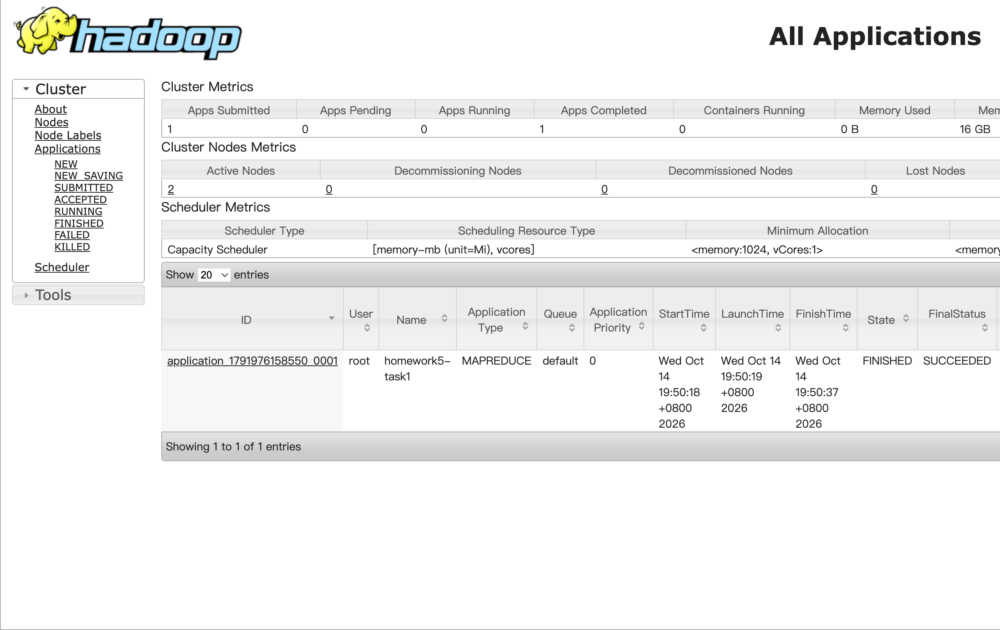
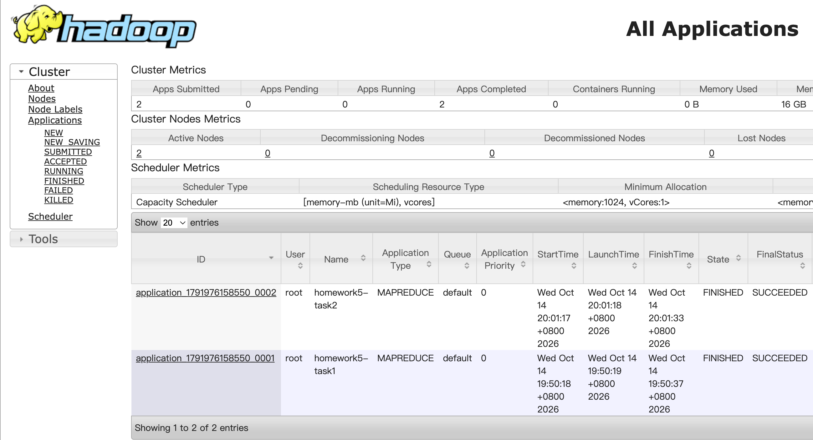

# 作业 5：基于 Hadoop MapReduce 的股票成分股集合分析

本次实验使用 Hadoop MapReduce，对老师提供的 `A.txt` 和 `B.txt` 两份股票成分股数据进行处理。每条记录由“指数编号”和“股票代码”组成，涉及的指数编号为 `101`、`102` 和 `103`。我分别编写了 `task1.java` 和 `task2.java`：前者判断同一指数下股票在两个文件中的集合关系，后者在前者的输出基础上统计交集、差集和并集的数量。

实验在 macOS 上使用 VS Code 编写代码、Maven 编译打包，并通过 Docker 中的 Hadoop 集群运行。项目目录如下：

```text
homework5/
├── data/
│   ├── A.txt
│   └── B.txt
├── src/
│   ├── task1.java
│   └── task2.java
├── target/
│   └── homework5-1.0-SNAPSHOT.jar
├── output/
│   ├── output_task1/
│   │   └── part-r-00000
│   └── output_task2/
│       └── part-r-00000
├── pom.xml
├── .gitignore
└── README.md
```

其中，`data` 存放原始输入文件，`src` 存放两个 MapReduce 程序，`target` 中的 JAR 用于提交 Hadoop 作业，`output` 保存从 HDFS 导出、用于提交的运行结果。提交时，`target` 目录只保留需要的 JAR 文件，其他编译中间文件通过 `.gitignore` 忽略。

## 一、pom.xml 的配置

本次实验没有采用 Maven 默认的多层 Java 源码目录，而是将 `task1.java`、`task2.java` 直接放在 `src` 中。因此，除了配置 Hadoop 依赖和 Java 编译版本，还需要调整 Maven 的源代码路径。

我的开发及运行环境如下：

| 环境        | 版本或说明                      |
| --------- | -------------------------- |
| 开发工具      | macOS、VS Code              |
| 本地 JDK    | Amazon Corretto 11.0.28    |
| Maven     | Apache Maven 3.10.0        |
| Hadoop    | 3.2.1（根据本次使用的 Docker 镜像标签） |
| 容器中的 Java | Java 8（根据 Docker 镜像标签）     |

由于本地使用 JDK 11，而 Hadoop 容器镜像采用 Java 8，我没有直接将 Java 11 作为编译目标，而是在 `pom.xml` 中指定 Java 8，以避免生成的字节码在容器运行时出现版本不兼容的问题。同时，我将 Hadoop 依赖版本设为 `3.2.1`，与所使用的 Hadoop 镜像版本对应。

以下是 `pom.xml` 中与环境相关的主要配置：

```xml
<properties>
    <project.build.sourceEncoding>UTF-8</project.build.sourceEncoding>
    <maven.compiler.release>8</maven.compiler.release>
    <hadoop.version>3.2.1</hadoop.version>
</properties>
```

依赖方面，我引入了 `hadoop-common` 和 `hadoop-mapreduce-client-core`，用于编译时调用 Hadoop 的文件系统、Mapper、Reducer 和 Job 等相关 API。两项依赖都使用 `${hadoop.version}`，以便统一管理版本；其 `scope` 设置为 `provided`，表示编译时使用这些库，实际运行时则由 Hadoop 集群提供，不需要将它们全部打入自己的 JAR 文件。

```xml
<dependencies>
    <dependency>
        <groupId>org.apache.hadoop</groupId>
        <artifactId>hadoop-common</artifactId>
        <version>${hadoop.version}</version>
        <scope>provided</scope>
    </dependency>
    <dependency>
        <groupId>org.apache.hadoop</groupId>
        <artifactId>hadoop-mapreduce-client-core</artifactId>
        <version>${hadoop.version}</version>
        <scope>provided</scope>
    </dependency>
</dependencies>
```

另外，Maven 默认从 `src/main/java` 查找 Java 源文件，而本项目的两个程序直接位于 `src` 下，所以我通过 `<sourceDirectory>src</sourceDirectory>` 指定源码位置，并使用 `maven-compiler-plugin`（版本 `3.11.0`）进行编译。项目的 `artifactId` 为 `homework5`、`version` 为 `1.0-SNAPSHOT`、打包类型为 `jar`，因此打包后的文件名为 `homework5-1.0-SNAPSHOT.jar`。

```xml
<build>
    <sourceDirectory>src</sourceDirectory>
    <plugins>
        <plugin>
            <groupId>org.apache.maven.plugins</groupId>
            <artifactId>maven-compiler-plugin</artifactId>
            <version>3.11.0</version>
        </plugin>
    </plugins>
</build>
```

在项目根目录执行以下命令进行编译打包：

```bash
mvn clean package
```

打包完成后，可以将生成的 JAR 文件复制到 Hadoop 主节点容器中，供两个任务共用：

```bash
docker cp target/homework5-1.0-SNAPSHOT.jar hadoop-master:/tmp/homework5.jar
```

**Maven 打包成功的终端输出（节选）：**

```text
[INFO] --------------------------------------------------
[INFO] BUILD SUCCESS
[INFO] --------------------------------------------------
```

## 二、Task1：判断 A、B 文件中的股票集合关系

### 1. 程序设计思路

Task1 的目标是：对于同一组“指数编号 + 股票代码”，判断它在 `A.txt` 和 `B.txt` 中的出现情况，并分别标记为：

- `BOTH`：A、B 两个文件中都出现；
- `A_ONLY`：只在 A 文件中出现；
- `B_ONLY`：只在 B 文件中出现。

我采用一个完整的 MapReduce 任务完成这个过程。

**Map 阶段**：通过 Hadoop 的 `MultipleInputs` 为 A、B 文件分别指定 `AFileMapper` 和 `BFileMapper`。两个 Mapper 使用相同的解析逻辑，但分别输出来源标记 `A` 或 `B`。其中，Key 为“指数编号 + 制表符 + 股票代码”，Value 为来源标记。这样，同一个指数下同一只股票的记录就会被归到一起。

**Shuffle 阶段**：Hadoop 根据 Key 对中间结果分组，将相同“指数编号 + 股票代码”的数据交给同一个 Reducer 处理。

**Reduce 阶段**：针对每个 Key，我使用 `inA`、`inB` 两个布尔变量判断该股票是否在两个来源中出现，然后输出对应的关系标记。因为这里只记录“是否出现”，即使同一文件内有重复记录，也不会将同一只股票重复输出。

最终，每个不同的“指数编号 + 股票代码”组合只生成一行记录，格式为：

```text
指数编号    股票代码    BOTH/A_ONLY/B_ONLY
```

### 2. 编写过程中需要注意的技术细节

首先，输入文件中的两列数据可能由空格或制表符分隔，因此在 Mapper 中使用 `trim()` 和 `split("\\s+")` 处理文本，同时跳过空行。如果非空记录不符合两列的格式，程序会抛出异常，避免把格式错误的数据误当作正常股票记录。

其次，不能仅根据股票代码进行分组。例如，同一个股票代码可能出现在不同指数中，所以必须把指数编号和股票代码共同作为 Key，保证不同指数的数据不会被混在一起。

另外，我没有通过文件名字符串去推测数据来源，而是利用 `MultipleInputs` 分别绑定 A、B 两个 Mapper。这种方法能够明确区分来源，也使后面的集合判断更加直接。

最后，我将 Reducer 数量设置为 `1`。由于 Hadoop 会对 `Text` Key 进行排序，而本实验的指数编号都是三位数，联合 Key 可以使最终输出按照指数编号、股票代码依次排列，并生成单个 `part-r-00000` 文件。

还需要注意的是，Hadoop 默认不允许将作业结果写入已经存在的输出目录。如果需要重新执行，应当先检查或备份原来的结果，再清理对应的 HDFS 输出目录，不能直接覆盖。

### 3. 程序运行与结果

首先将输入数据复制到容器并上传 HDFS：

```bash
docker cp data/A.txt hadoop-master:/tmp/A.txt
docker cp data/B.txt hadoop-master:/tmp/B.txt
docker exec hadoop-master hdfs dfs -mkdir -p /homework5/input
docker exec hadoop-master hdfs dfs -put -f /tmp/A.txt /tmp/B.txt /homework5/input/
```

然后运行 Task1：

```bash
docker exec hadoop-master hadoop jar /tmp/homework5.jar task1 /homework5/input/A.txt /homework5/input/B.txt /homework5/output_task1
```

查看 HDFS 中的输出结果：

```bash
docker exec hadoop-master hdfs dfs -cat /homework5/output_task1/part-r-00000
```

**Task1 运行成功的命令行日志：**

```Shell
2026-10-14 11:50:16,622 INFO client.RMProxy: Connecting to ResourceManager at resourcemanager/172.18.0.5:8032 2026-10-14 11:50:16,954 WARN mapreduce.JobResourceUploader: Hadoop command-line option parsing not performed. Implement the Tool interface and execute your application with ToolRunner to remedy this. 2026-10-14 11:50:16,977 INFO mapreduce.JobResourceUploader: Disabling Erasure Coding for path: /tmp/hadoop-yarn/staging/root/.staging/job_1791976158550_0001 2026-10-14 11:50:17,047 INFO sasl.SaslDataTransferClient: SASL encryption trust check: localHostTrusted = false, remoteHostTrusted = false 2026-10-14 11:50:17,198 INFO input.FileInputFormat: Total input files to process : 1 2026-10-14 11:50:17,229 INFO input.FileInputFormat: Total input files to process : 1 2026-10-14 11:50:17,253 INFO sasl.SaslDataTransferClient: SASL encryption trust check: localHostTrusted = false, remoteHostTrusted = false 2026-10-14 11:50:17,731 INFO sasl.SaslDataTransferClient: SASL encryption trust check: localHostTrusted = false, remoteHostTrusted = false 2026-10-14 11:50:18,188 INFO mapreduce.JobSubmitter: number of splits:2 2026-10-14 11:50:18,340 INFO sasl.SaslDataTransferClient: SASL encryption trust check: localHostTrusted = false, remoteHostTrusted = false 2026-10-14 11:50:18,376 INFO mapreduce.JobSubmitter: Submitting tokens for job: job_1791976158550_0001 2026-10-14 11:50:18,376 INFO mapreduce.JobSubmitter: Executing with tokens: [] 2026-10-14 11:50:18,497 INFO conf.Configuration: resource-types.xml not found 2026-10-14 11:50:18,497 INFO resource.ResourceUtils: Unable to find 'resource-types.xml'. 2026-10-14 11:50:18,691 INFO impl.YarnClientImpl: Submitted application application_1791976158550_0001 2026-10-14 11:50:18,744 INFO mapreduce.Job: The url to track the job: http://resourcemanager:8088/proxy/application_1791976158550_0001/ 2026-10-14 11:50:18,744 INFO mapreduce.Job: Running job: job_1791976158550_0001 2026-10-14 11:50:27,005 INFO mapreduce.Job: Job job_1791976158550_0001 running in uber mode : false 2026-10-14 11:50:27,014 INFO mapreduce.Job: map 0% reduce 0% 2026-10-14 11:50:33,140 INFO mapreduce.Job: map 50% reduce 0% 2026-10-14 11:50:34,177 INFO mapreduce.Job: map 100% reduce 0% 2026-10-14 11:50:39,265 INFO mapreduce.Job: map 100% reduce 100% 2026-10-14 11:50:39,276 INFO mapreduce.Job: Job job_1791976158550_0001 completed successfully 2026-10-14 11:50:39,428 INFO mapreduce.Job: Counters: 54 File System Counters FILE: Number of bytes read=7378 FILE: Number of bytes written=697939 FILE: Number of read operations=0 FILE: Number of large read operations=0 FILE: Number of write operations=0 HDFS: Number of bytes read=5418 HDFS: Number of bytes written=8191 HDFS: Number of read operations=11 HDFS: Number of large read operations=0 HDFS: Number of write operations=2 HDFS: Number of bytes read erasure-coded=0 Job Counters Launched map tasks=2 Launched reduce tasks=1 Rack-local map tasks=2 Total time spent by all maps in occupied slots (ms)=6468 Total time spent by all reduces in occupied slots (ms)=2629 Total time spent by all map tasks (ms)=6468 Total time spent by all reduce tasks (ms)=2629 Total vcore-milliseconds taken by all map tasks=6468 Total vcore-milliseconds taken by all reduce tasks=2629 Total megabyte-milliseconds taken by all map tasks=6623232 Total megabyte-milliseconds taken by all reduce tasks=2692096 Map-Reduce Framework Map input records=605 Map output records=605 Map output bytes=6162 Map output materialized bytes=7384 Input split bytes=468 Combine input records=0 Combine output records=0 Reduce input groups=547 Reduce shuffle bytes=7384 Reduce input records=605 Reduce output records=547 Spilled Records=1210 Shuffled Maps =2 Failed Shuffles=0 Merged Map outputs=2 GC time elapsed (ms)=195 CPU time spent (ms)=940 Physical memory (bytes) snapshot=1059381248 Virtual memory (bytes) snapshot=9810526208 Total committed heap usage (bytes)=762839040 Peak Map Physical memory (bytes)=380084224 Peak Map Virtual memory (bytes)=3268820992 Peak Reduce Physical memory (bytes)=300138496 Peak Reduce Virtual memory (bytes)=3276587008 Shuffle Errors BAD_ID=0 CONNECTION=0 IO_ERROR=0 WRONG_LENGTH=0 WRONG_MAP=0 WRONG_REDUCE=0 File Input Format Counters Bytes Read=0 File Output Format Counters Bytes Written=8191
```

**Task1 输出文件的部分内容（前10行）：**

```text
101	AAPL	A_ONLY
101	AMGN	A_ONLY
101	AXP	A_ONLY
101	BA	A_ONLY
101	CAT	A_ONLY
101	CRM	A_ONLY
101	CSCO	A_ONLY
101	DIS	A_ONLY
101	DOW	A_ONLY
101	GS	A_ONLY
```

从实际执行日志可以看到，Task1 共读取 `605` 条原始记录，最终输出 `547` 个不同的“指数编号 + 股票代码”组合；Map 和 Reduce 均执行完成，作业状态为成功。输出结果保存在 HDFS 的 `/homework5/output_task1` 中。

**Task1 的 YARN Web 页面运行成功截图：**


## 三、Task2：统计每个指数的交集、差集与并集数量

### 1. 程序设计思路

Task2 不再读取最初的 `A.txt` 和 `B.txt`，而是直接读取 Task1 已经生成的集合关系结果，完成第二次 MapReduce 统计。这样可以复用 Task1 对数据来源的判断与去重结果，不需要再次处理原始文件。

**Map 阶段**：逐行读取 Task1 的输出，拆分出“指数编号、股票代码、关系标记”三列，以指数编号作为 Key，以 `BOTH`、`A_ONLY` 或 `B_ONLY` 作为 Value 输出。

**Shuffle 阶段**：Hadoop 将同一个指数编号对应的关系标记汇总到同一个 Reducer。

**Reduce 阶段**：使用三个计数器 `both`、`aOnly` 和 `bOnly`，分别统计交集、A 独有和 B 独有股票数量。由于 Task1 已保证每个“指数编号 + 股票代码”只出现一次，因此 Task2 可以直接对这些标记进行计数。最后通过以下公式计算并集数量：

```text
并集数量 = BOTH 数量 + A_ONLY 数量 + B_ONLY 数量
```

最终输出五列数据，分别为“指数编号、交集数量、A 独有数量、B 独有数量、并集数量”。

### 2. 编写过程中需要注意的技术细节

Task2 的输入格式与 Task1 的原始输入不同：它需要读取三列，而不是两列。因此 Mapper 必须按照 Task1 的输出格式解析数据，并检查关系标记是否属于 `BOTH`、`A_ONLY`、`B_ONLY` 三种情况，防止不符合预期的中间数据影响统计结果。

另外，Task2 的统计结果依赖于 Task1 的去重。如果直接对未经去重的 A、B 原始数据进行计数，重复股票就可能导致数量偏大。这也是我将两个任务分开处理的一个原因。

为了便于提交和检查，我同样将 Reducer 数量设置为 `1`，使三个指数的结果按照编号顺序写入同一个 `part-r-00000` 文件。计数器使用 `long` 类型，便于今后处理更多数据。

### 3. 程序运行与结果

在 Task1 成功生成输出后，运行 Task2：

```bash
docker exec hadoop-master hadoop jar /tmp/homework5.jar task2 /homework5/output_task1 /homework5/output_task2
```

查看统计结果：

```bash
docker exec hadoop-master hdfs dfs -cat /homework5/output_task2/part-r-00000
```

**Task2 运行成功的命令行日志：**

```Shell
2026-10-14 12:01:16,475 INFO client.RMProxy: Connecting to ResourceManager at resourcemanager/172.18.0.5:8032 2026-10-14 12:01:16,831 WARN mapreduce.JobResourceUploader: Hadoop command-line option parsing not performed. Implement the Tool interface and execute your application with ToolRunner to remedy this. 2026-10-14 12:01:16,866 INFO mapreduce.JobResourceUploader: Disabling Erasure Coding for path: /tmp/hadoop-yarn/staging/root/.staging/job_1791976158550_0002 2026-10-14 12:01:16,935 INFO sasl.SaslDataTransferClient: SASL encryption trust check: localHostTrusted = false, remoteHostTrusted = false 2026-10-14 12:01:17,073 INFO input.FileInputFormat: Total input files to process : 1 2026-10-14 12:01:17,121 INFO sasl.SaslDataTransferClient: SASL encryption trust check: localHostTrusted = false, remoteHostTrusted = false 2026-10-14 12:01:17,180 INFO sasl.SaslDataTransferClient: SASL encryption trust check: localHostTrusted = false, remoteHostTrusted = false 2026-10-14 12:01:17,212 INFO mapreduce.JobSubmitter: number of splits:1 2026-10-14 12:01:17,337 INFO sasl.SaslDataTransferClient: SASL encryption trust check: localHostTrusted = false, remoteHostTrusted = false 2026-10-14 12:01:17,781 INFO mapreduce.JobSubmitter: Submitting tokens for job: job_1791976158550_0002 2026-10-14 12:01:17,782 INFO mapreduce.JobSubmitter: Executing with tokens: [] 2026-10-14 12:01:17,942 INFO conf.Configuration: resource-types.xml not found 2026-10-14 12:01:17,942 INFO resource.ResourceUtils: Unable to find 'resource-types.xml'. 2026-10-14 12:01:18,013 INFO impl.YarnClientImpl: Submitted application application_1791976158550_0002 2026-10-14 12:01:18,043 INFO mapreduce.Job: The url to track the job: http://resourcemanager:8088/proxy/application_1791976158550_0002/ 2026-10-14 12:01:18,044 INFO mapreduce.Job: Running job: job_1791976158550_0002 2026-10-14 12:01:24,141 INFO mapreduce.Job: Job job_1791976158550_0002 running in uber mode : false 2026-10-14 12:01:24,143 INFO mapreduce.Job: map 0% reduce 0% 2026-10-14 12:01:29,235 INFO mapreduce.Job: map 100% reduce 0% 2026-10-14 12:01:34,332 INFO mapreduce.Job: map 100% reduce 100% 2026-10-14 12:01:35,381 INFO mapreduce.Job: Job job_1791976158550_0002 completed successfully 2026-10-14 12:01:35,505 INFO mapreduce.Job: Counters: 54 File System Counters FILE: Number of bytes read=7001 FILE: Number of bytes written=468957 FILE: Number of read operations=0 FILE: Number of large read operations=0 FILE: Number of write operations=0 HDFS: Number of bytes read=8312 HDFS: Number of bytes written=47 HDFS: Number of read operations=8 HDFS: Number of large read operations=0 HDFS: Number of write operations=2 HDFS: Number of bytes read erasure-coded=0 Job Counters Launched map tasks=1 Launched reduce tasks=1 Rack-local map tasks=1 Total time spent by all maps in occupied slots (ms)=2817 Total time spent by all reduces in occupied slots (ms)=2881 Total time spent by all map tasks (ms)=2817 Total time spent by all reduce tasks (ms)=2881 Total vcore-milliseconds taken by all map tasks=2817 Total vcore-milliseconds taken by all reduce tasks=2881 Total megabyte-milliseconds taken by all map tasks=2884608 Total megabyte-milliseconds taken by all reduce tasks=2950144 Map-Reduce Framework Map input records=547 Map output records=547 Map output bytes=5901 Map output materialized bytes=7001 Input split bytes=121 Combine input records=0 Combine output records=0 Reduce input groups=3 Reduce shuffle bytes=7001 Reduce input records=547 Reduce output records=3 Spilled Records=1094 Shuffled Maps =1 Failed Shuffles=0 Merged Map outputs=1 GC time elapsed (ms)=141 CPU time spent (ms)=760 Physical memory (bytes) snapshot=689205248 Virtual memory (bytes) snapshot=6549618688 Total committed heap usage (bytes)=472383488 Peak Map Physical memory (bytes)=388194304 Peak Map Virtual memory (bytes)=3270373376 Peak Reduce Physical memory (bytes)=301010944 Peak Reduce Virtual memory (bytes)=3279245312 Shuffle Errors BAD_ID=0 CONNECTION=0 IO_ERROR=0 WRONG_LENGTH=0 WRONG_MAP=0 WRONG_REDUCE=0 File Input Format Counters Bytes Read=8191 File Output Format Counters Bytes Written=47
```

**Task2 输出文件的内容：**

```text
101	3	13	4	20
102	3	19	3	25
103	52	195	255	502
```

本次实验实际得到的统计结果如下：

| 指数编号 | 交集数量 | A 独有数量 | B 独有数量 | 并集数量 |
| ---- | ---: | -----: | -----: | ---: |
| 101  |    3 |     13 |      4 |   20 |
| 102  |    3 |     19 |      3 |   25 |
| 103  |   52 |    195 |    255 |  502 |

从日志可以看到，Task2 读取了 Task1 输出的 `547` 条记录，最终输出 `3` 条指数统计结果，作业成功完成。对照原始数据检查后，三个指数的统计结果符合集合运算关系，例如每一行均满足“交集 + A 独有 + B 独有 = 并集”。

**Task2 的 YARN Web 页面运行成功截图：**



两个任务完成后，我将 HDFS 中的结果导出到本地 `output` 文件夹，便于一起提交：

```bash
mkdir -p output/output_task1 output/output_task2
docker exec hadoop-master hdfs dfs -cat /homework5/output_task1/part-r-00000 > output/output_task1/part-r-00000
docker exec hadoop-master hdfs dfs -cat /homework5/output_task2/part-r-00000 > output/output_task2/part-r-00000
```

Hadoop 运行成功的 Web 页面可以通过宿主机浏览器访问 `http://localhost:8088/`（YARN ResourceManager 页面）进行查看，并在其中找到对应的成功作业截图。提交前可以新建 `screenshots` 文件夹存放图片，并将上面的截图占位注释替换为实际的 Markdown 图片链接。

## 四、实验中遇到的困难

在完成 Task1 后，我原本以为可以直接使用同一个 JAR 文件运行 Task2，但第一次执行时遇到了以下错误：

```text
Exception in thread "main" java.lang.ClassNotFoundException: task2
```

由于 Task1 已经能够正常运行，而且 Task2 当时还没有真正进入 MapReduce 计算阶段，我首先考虑的不是 Hadoop 集群或输入数据的问题，而是程序打包和类加载的问题。这个报错表示 Hadoop 在当前使用的 JAR 中没有找到可加载的 `task2` 主类。

排查时，我重点检查了以下几个方面：

1. `task2.java` 是否已经保存，且类名确实为 `task2`（Java 类名区分大小写）；
2. `pom.xml` 中是否包含 `<sourceDirectory>src</sourceDirectory>`，确保 Maven 会编译直接放在 `src` 下的文件；
3. 本地新生成的 JAR 是否包含 `task2.class`；
4. Docker 容器中的 `/tmp/homework5.jar` 是否仍然是之前复制的旧版本。

对应的检查和处理命令为：

```bash
mvn clean package
jar tf target/homework5-1.0-SNAPSHOT.jar | grep 'task2'
docker cp target/homework5-1.0-SNAPSHOT.jar hadoop-master:/tmp/homework5.jar
```

重新确认打包文件并更新容器内使用的 JAR 后，再执行 Task2 的运行命令，后续作业成功完成。由于没有保留第一次失败时的 JAR 内容检查记录，我不能完全确定当时究竟是 Task2 未被打包，还是容器中使用了旧 JAR；但可以确定问题出在运行时加载 `task2` 类这一环节，而不是 Task2 的集合统计逻辑。

通过这次问题，我认识到：修改或新增 Java 源代码后，不仅需要重新执行 Maven 打包，还要把更新后的 JAR 重新复制到 Docker 容器中。只更新本地代码，并不会自动更新 Hadoop 实际运行的程序。

## 五、实验分析

### 1. 正确性与结果检查

两个任务之间形成了比较清晰的处理流程：Task1 先按照“指数编号 + 股票代码”去重并分类，Task2 再对分类结果计数。从实际输出看，Task1 产生的 `547` 条唯一记录恰好成为 Task2 的输入，Task2 最终生成了三个指数的统计结果。并且每个指数的并集数量都等于三种关系的数量之和，说明结果在数量关系上是自洽的。

在更大规模的数据上，除了检查总数，还可以增加少量人工构造的数据进行测试，例如同一股票只出现在 A 中、只出现在 B 中、在两个文件中都出现，以及同一文件出现重复记录等情况，以进一步确认分类逻辑正确。

### 2. 性能方面的不足

为了让结果按照题目要求有序输出，并且只生成一个结果文件，我在两个任务中都设置了一个 Reducer。这对本次数据规模来说比较方便，但如果股票记录数量大幅增加，所有数据最终都需要经过一个 Reduce 任务，就可能形成处理瓶颈，无法充分发挥 Hadoop 并行计算的优势。

此外，本实验分成两个 MapReduce 作业，Task1 的输出需要先写入 HDFS，再由 Task2 读取。这种方式思路清晰，也方便逐步检查，但会增加一次中间结果的读写和作业启动开销。对于当前规模较小的数据来说，这部分开销可能比实际的集合计算还明显。

### 3. 扩展性与可能的改进

如果以后需要处理更多指数或更大规模的股票数据，我认为可以从以下几个方向改进：

- **增加并行度**：使用多个 Reducer 分担不同指数或股票组合的计算；不过多 Reducer 会产生多个输出文件，如果仍要求整体排序，还需要进一步设计分区和结果合并方案。
- **减少中间数据传输**：Task2 可以考虑先在 Mapper 端对不同关系进行局部计数，再使用 Combiner 汇总，减少 Shuffle 阶段的数据量。这需要把目前直接传递关系字符串的形式调整为便于相加的计数结构。
- **提高异常数据处理能力**：目前遇到列数不正确或关系标记无效的记录时，程序会抛出异常。后续可以采用计数器记录异常行，或将异常数据写入单独的输出位置，避免个别错误记录影响整个任务。
- **提高复用性**：将输入输出路径、Reducer 数量等内容改成更灵活的参数，并补充自动化测试，使程序更容易用于其他具有相同数据格式的集合统计任务。

总的来说，这次实验让我更具体地理解了 MapReduce 中 Map、Shuffle 和 Reduce 的分工，也体会到程序正确运行不仅取决于算法，还与 Maven 打包、Docker 文件同步、HDFS 输入输出以及 YARN 作业提交等环节有关。虽然目前的实现主要面向本次作业的数据规模，但它已经完成了要求的集合关系判断和二次统计，也为以后处理更大规模的数据提供了可以继续改进的基础。
